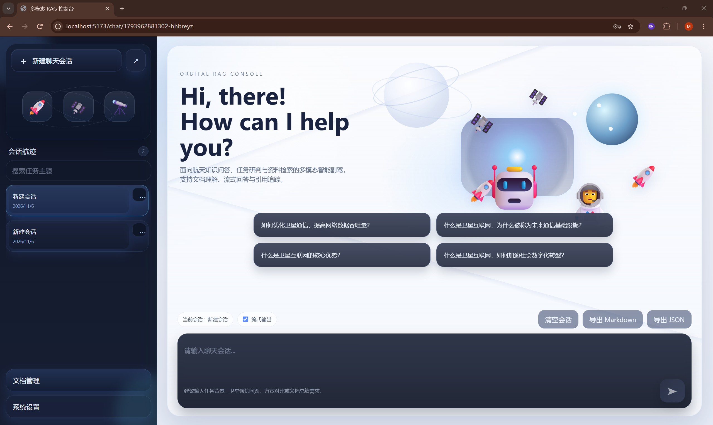
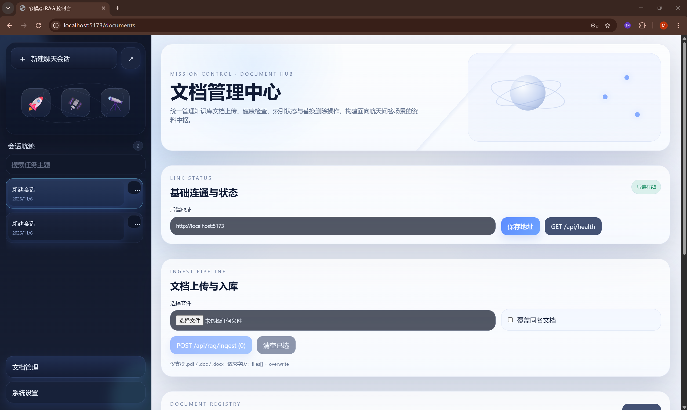
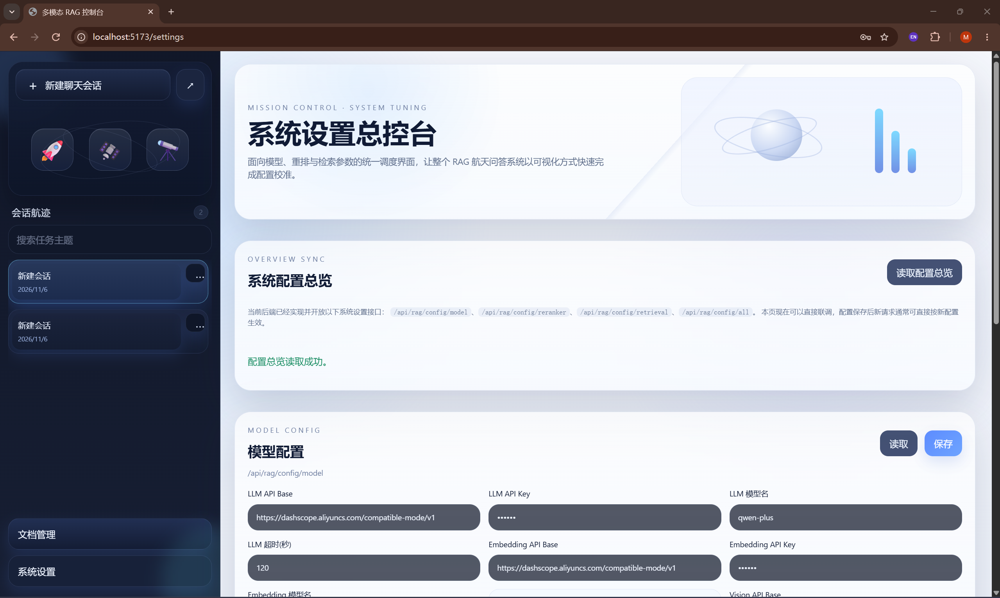

# 多模态文档检索 RAG 系统

基于 Vue 3、FastAPI、LangChain、SQLite 和 Chroma 的文档知识库问答应用，支持 PDF、DOC、DOCX 上传、父子切片、摘要索引、图片描述索引、向量检索、可选 Reranker 和带引用的问答。

推荐使用 Docker Compose 启动前端、后端和 Chroma；LLM、Embedding、Vision 通过外部模型 API 调用。使用云端模型时无需本地 GPU，也无需额外部署模型容器。

## 界面展示

### 聊天首页

提供会话管理、示例问题、问答输入和会话导出入口。



### 文档管理

统一管理文档上传、后端连接检查和知识库入库操作。



### 系统设置

通过可视化页面管理模型接口、密钥、重排开关和检索参数。



## 1. 技术架构

```text
浏览器 → rag-web（Nginx + Vue，5173）
              ↓ /api 反向代理
         rag-api（FastAPI，8010）
              ├── SQLite：文档、切片、图片元数据和模型配置
              ├── chroma（8000）：摘要、子块和图片 Caption 向量
              ├── LLM API：摘要生成和问答
              ├── Embedding API：文本向量化
              ├── Vision API（可选）：图片描述生成
              └── Reranker API（可选）：候选证据重排
```

| 模块 | 技术 / 说明 |
| --- | --- |
| 前端 | Vue 3、TypeScript、Vite、Pinia、Vue Router、Axios / Fetch |
| 后端 | Python 3.11、FastAPI、Uvicorn、Pydantic、SQLAlchemy |
| RAG | LangChain、RecursiveCharacterTextSplitter、Chroma |
| 文档解析 | PyMuPDF 解析 PDF；ZIP/XML 解析 DOCX；antiword 解析 DOC |
| 模型接入 | ChatOpenAI、OpenAIEmbeddings、OpenAI SDK |
| 默认模型示例 | `qwen-plus`、`text-embedding-v3`、`qwen-vl-max-latest` |
| 部署 | Docker Compose、Nginx |

父块切片长度为 1200 字符、重叠 150；子块为 300 字符、重叠 60。父块摘要、子块正文、可选的图片 Caption 统一写入 Chroma。图片通过“视觉模型生成描述 → 文本 Embedding”参与检索，原图保留用于溯源展示。

## 2. 需要哪些 Docker 容器

| Compose 服务 | 容器名称 | 镜像来源 | 宿主机端口 | 用途 |
| --- | --- | --- | --- | --- |
| `chroma` | `rag-chroma` | `chromadb/chroma:0.6.3` | `8000` | 独立向量数据库 |
| `rag-api` | `rag-api` | 使用根目录 `Dockerfile` 本地构建 | `8010` | RAG 后端 |
| `rag-web` | `rag-web` | 使用 `frontend/Dockerfile` 本地构建 | `5173` → 容器 `80` | 前端与 API 代理 |

SQLite 是后端进程直接访问的文件数据库，**不需要单独的数据库容器**；当前 Compose 也不依赖 MySQL、Redis、Elasticsearch 或独立 Reranker 容器。

构建应用还会使用以下基础镜像，Docker 会自动拉取：

- `docker.m.daocloud.io/library/python:3.11-slim`
- `docker.m.daocloud.io/library/node:22.20.0-alpine`
- `docker.m.daocloud.io/library/nginx:1.27-alpine`

Node 仅用于前端构建阶段，最终前端由 Nginx 提供服务。Dockerfile 已安装解析 DOC 所需的 `antiword`，普通文本型 PDF 不需要另外启动 OCR 容器。

## 3. 环境准备

1. 安装并启动 Docker，确保支持 `docker compose`。Windows 推荐 Docker Desktop + WSL 2，并使用 Linux containers。
2. 确认 `8000`、`8010`、`5173` 端口未被占用。
3. 准备可用的 LLM 和 Embedding API Key，例如阿里云百炼 / DashScope 的密钥，确认对应地域、模型权限和额度可用。
4. 确保构建环境能够访问镜像仓库、Debian 软件源、PyPI 和 npm；运行中的后端容器需要能够访问模型 API。

```bash
docker --version
docker compose version
docker info
```

以下 Compose 命令均在本文件所在目录执行：如果仓库保留了外层目录结构，先进入 `source`；如果直接将 `source` 发布为仓库根目录，则在仓库根目录执行。

```bash
cd source
```

## 4. 配置模型密钥

### 4.1 创建本地配置文件

Windows PowerShell：

```powershell
# 若已有 .env，请直接编辑原文件，保留自己的有效配置。
if (-not (Test-Path .env)) { Copy-Item .env.example .env }
notepad .env
```

Linux / macOS：

```bash
test -f .env || cp .env.example .env
# 使用自己习惯的编辑器编辑 .env
```

完整变量见 [.env.example](.env.example)，至少替换以下占位符：

```dotenv
LLM_API_BASE=https://dashscope.aliyuncs.com/compatible-mode/v1
LLM_API_KEY=replace-with-your-dashscope-api-key
LLM_MODEL_NAME=qwen-plus

EMBEDDING_API_BASE=https://dashscope.aliyuncs.com/compatible-mode/v1
EMBEDDING_API_KEY=replace-with-your-dashscope-api-key
EMBEDDING_MODEL_NAME=text-embedding-v3
```

示例采用 DashScope OpenAI 兼容地址；若账户属于其他地域或使用其他供应商，按供应商文档替换 API Base 和模型名。LLM 与 Embedding 可以共用同一把有对应权限的 DashScope Key，也可以分别配置。使用 `ChatOpenAI` / `OpenAIEmbeddings` 不代表必须购买 OpenAI 的 API Key。

容器部署保留以下连接和存储配置：

```dotenv
SQLITE_URL=sqlite:///./data/rag.db
CHROMA_HOST=chroma
CHROMA_PORT=8000
CHROMA_COLLECTION=rag_chunks
UPLOADS_DIR=./data/uploads
IMAGES_DIR=./data/images
```

`chroma` 是 Compose 网络内的服务名；在后端容器中填写 `localhost` 会指向后端容器自身，无法连接 Chroma。

### 4.2 可选：开启图片语义索引

```dotenv
ENABLE_VISION=true
VISION_API_BASE=https://dashscope.aliyuncs.com/compatible-mode/v1
VISION_API_KEY=replace-with-your-vision-api-key
VISION_MODEL_NAME=qwen-vl-max-latest
```

关闭 Vision 时仍会提取和保存图片，但不会生成图片 Caption 向量。开启后只影响后续入库；已经入库的文档需要覆盖上传或重建才能补充图片索引。使用云端模型会将相应文本或图片发送给所配置的服务，并可能产生 API 费用。

### 4.3 可选：配置 Reranker

Reranker 不属于启动应用的必需依赖。建议先完成文本入库和问答，再接入重排服务。

```dotenv
RERANKER_ENABLED=false
RERANKER_API_BASE=
RERANKER_API_KEY=
RERANKER_MODEL_NAME=
RERANKER_TIMEOUT=60
```

当前实现通过 OpenAI SDK 向 `<RERANKER_API_BASE>/reranks` 发送请求，请确认服务支持以下协议，再填写地址、Key 和模型名并开启重排：

```json
{
  "model": "your-reranker-model",
  "query": "用户问题",
  "documents": ["候选证据一", "候选证据二"],
  "top_n": 8
}
```

响应需包含带候选下标的结果，例如：

```json
{
  "results": [
    {"index": 1, "relevance_score": 0.95},
    {"index": 0, "relevance_score": 0.82}
  ]
}
```

`index` 从 0 开始。供应商的 `/rerank`、DashScope 原生接口等路径或请求格式可能不同，不能仅靠替换模型名保证兼容；需要对应的协议适配。配置变量名为 `RERANKER_API_BASE`，旧的 `RERANKER_BASE_URL` 不会被当前配置类读取。

**当前初始化代码会将数据库中的 Reranker 开关设为 `true`，即使 `.env` 填写了 `RERANKER_ENABLED=false`。没有重排服务时，启动后请在“系统设置 → Reranker 配置”取消启用并保存。** 调用失败时系统会降级到原始召回顺序，并在回答中显示降级状态。

### 4.4 配置优先级与后续修改

- 首次创建数据库时，从环境变量 / `.env` 初始化 `model_configs` 中的默认记录。
- 后续请求优先使用数据库已保存的模型和检索配置，数据库中非空的 Key 也优先使用。
- 修改现有系统的模型、Key、Vision、Reranker 或检索参数时，优先通过前端“系统设置”保存；不要认为修改 `.env` 一定能覆盖旧数据库记录。
- 当前设置页读取密钥时显示 `******`；保存模型配置时，Embedding 和已启用的 Vision 请重新填写真实 Key，避免当前保存逻辑将掩码写成密钥。
- 修改 `.env` 中的连接信息后，使用 `docker compose up -d --force-recreate rag-api` 重新创建后端容器；仅 `restart` 不会刷新 Compose 注入的环境变量。
- 更换 Embedding 模型后，已有向量不再保证兼容，应使用新 collection 并重建知识库，避免新旧向量混用。

## 5. 拉取镜像并启动

### 5.1 拉取 Chroma 与构建基础镜像

```bash
docker compose pull chroma
docker pull docker.m.daocloud.io/library/python:3.11-slim
docker pull docker.m.daocloud.io/library/node:22.20.0-alpine
docker pull docker.m.daocloud.io/library/nginx:1.27-alpine
```

也可只执行第一条，后续构建会自动获取其余镜像。`rag-api` 和 `rag-web` 没有预发布镜像，不能直接按容器名执行 `docker pull`。

Dockerfile 当前使用 DaoCloud 镜像地址；如果该地址不可访问，可将两个 Dockerfile 中的基础镜像分别改为官方 `python:3.11-slim`、`node:22.20.0-alpine`、`nginx:1.27-alpine`，然后重新构建。镜像源是否可用取决于所在网络。

### 5.2 检查配置、构建和启动

```bash
# 静默校验，不把展开后的密钥打印到终端。
docker compose config --quiet

# 首次构建包含 Python 依赖安装和前端编译，可能耗时较长。
docker compose build

docker compose up -d
docker compose ps
```

也可以用 `docker compose up -d --build` 完成构建和启动。后端 Dockerfile 当前安装 [requirements.txt](requirements.txt) 中的完整依赖，镜像体积和构建耗时会相对较大；[requirements-rag.txt](requirements-rag.txt) 是另一份精简依赖清单，当前 Dockerfile 没有使用它。

Compose 的 `depends_on` 只保证启动顺序，没有配置就绪检测。首次启动请查看日志，确认 Chroma 和 API 已就绪后再上传文档：

```bash
docker compose logs --tail=100 chroma rag-api rag-web
```

### 5.3 访问地址与验证

| 功能 | 地址 |
| --- | --- |
| 前端应用 | [http://localhost:5173](http://localhost:5173) |
| 聊天页面 | [http://localhost:5173/chat](http://localhost:5173/chat) |
| 文档管理 | [http://localhost:5173/documents](http://localhost:5173/documents) |
| 系统设置 | [http://localhost:5173/settings](http://localhost:5173/settings) |
| API 文档 | [http://localhost:8010/docs](http://localhost:8010/docs) |
| 健康检查 | [http://localhost:8010/api/health](http://localhost:8010/api/health) |
| 后端简易管理台 | [http://localhost:8010/api/rag/console](http://localhost:8010/api/rag/console) |

PowerShell 中验证：

```powershell
Invoke-RestMethod http://localhost:8010/api/health
Invoke-RestMethod http://localhost:5173/api/health
```

两者应返回 `status: ok`，第二条同时验证 Nginx 到后端的代理。健康接口只说明 API 进程可响应，不代表 Chroma、模型密钥或重排服务已可用，完整链路需通过实际上传和问答验证。

## 6. 第一次使用

1. 打开“系统设置”，核对模型配置；未准备 Reranker 时关闭重排并保存。
2. 打开“文档管理”，上传一份较小的文本型 PDF 或 DOCX。
3. 等待解析、父子切片、父块摘要生成和向量化完成，确认文档状态为 `ready`。
4. 打开“聊天”，提出与该文档直接相关的问题，检查回答及引用位置。
5. 需要图片检索时，先开启 Vision 并保存有效密钥，再重新入库含图片的文档，尝试“文档中的结构示意图是什么”等问题。

默认通过 Nginx 同源代理访问后端，无需手动填写 API 地址。如果之前在页面保存过其他 API Base，可在文档管理页将其设置回 `http://localhost:5173`；远程服务器部署时填该服务器的实际前端地址。

### API 示例（PowerShell）

上传文档前，请将路径替换为自己的文件路径：

```powershell
curl.exe -X POST "http://localhost:8010/api/rag/ingest" -F "files=@D:/documents/example.pdf" -F "overwrite=false"
```

入库成功后发起非 SSE 问答：

```powershell
$askBody = @{ question = "这份文档的主要内容是什么？"; stream = $false } | ConvertTo-Json
Invoke-RestMethod -Method Post -Uri "http://localhost:8010/api/rag/ask" -ContentType "application/json; charset=utf-8" -Body ([System.Text.Encoding]::UTF8.GetBytes($askBody))
```

`overwrite=true` 会删除重复文档的旧索引并重新构建，使用前确认确实需要覆盖。

## 7. 数据持久化与日常维护

```text
data/
├── rag.db      # SQLite：文档、切片、图片元数据和模型配置（含密钥）
├── chroma/     # Chroma 持久化索引
├── uploads/    # 上传的源文档
└── images/     # 提取的图片
```

后端将当前目录挂载到 `/app`，Chroma 将 `./data/chroma` 挂载到 `/chroma/chroma`。默认持久化数据保存在宿主机目录；正常停止或重建容器不会删除这些绑定挂载目录。

```bash
# 查看状态 / 跟踪后端日志（Ctrl+C 结束日志查看）
docker compose ps
docker compose logs -f rag-api

# 重新构建应用并启动
docker compose up -d --build

# 停止并移除本项目容器和 Compose 网络，保留宿主机 data 目录
docker compose down
```

备份时先停止服务，再复制完整 `data/` 目录，避免 SQLite 与向量索引处于不同时间点；恢复后保持模型、collection 和文件路径配置一致。备份含上传原文和模型密钥，应保存在私人位置。

## 8. 切换为本地模型服务

本地 LLM / Embedding 服务需提供当前客户端可用的 OpenAI 兼容接口，服务地址及模型名可通过设置页调整。模型服务容器不包含在本仓库 Compose 中，需自行部署。

后端运行于 Docker 中，访问宿主机模型服务时，Docker Desktop 通常使用：

```dotenv
LLM_API_BASE=http://host.docker.internal:8001/v1
EMBEDDING_API_BASE=http://host.docker.internal:8002/v1
```

上面的端口仅作示例，应替换为实际监听端口。Linux Docker Engine 可在 `rag-api` 服务下加入以下配置，再重新创建容器：

```yaml
extra_hosts:
  - "host.docker.internal:host-gateway"
```

宿主机模型服务需监听容器可访问的网卡地址；访问另一台机器时使用其局域网 IP。若模型服务也在 Docker 中，可加入同一网络并使用对应的服务名。API Base 填 API 前缀，如 `/v1`，不要填完整的 `/chat/completions`。

## 9. 常见问题

| 问题 | 检查方式 / 处理建议 |
| --- | --- |
| `Cannot connect to the Docker daemon` | 启动 Docker Desktop / Docker 服务，确认使用 Linux containers |
| 端口已被占用 | 修改 Compose 左侧宿主机端口，例如 `"5174:80"`；服务间仍使用原容器端口 |
| 无法连接 Chroma | 查看 `docker compose logs chroma`，确认容器已就绪，后端的 `CHROMA_HOST=chroma`、端口为 `8000` |
| 文档管理返回 502，API 反复重启 | 查看 `docker compose logs --tail=80 rag-api`；`ENABLE_VISION` 使用 `true` / `false`，当前配置读取会忽略空环境变量并采用默认值；修正 `.env` 后执行 `docker compose up -d --force-recreate rag-api`，必要时重启 `rag-web` 刷新代理地址 |
| 修改 `.env` 后模型没变 | 数据库配置优先，使用系统设置更新；环境变量更新需重新创建 API 容器 |
| 模型返回 401 / 403 | 核对 Key、地域、权限和额度；保存设置时重新填写 Embedding / Vision 的真实 Key |
| Reranker 返回 404 / 降级 | 核对服务是否支持 `/reranks` 和本文请求格式；未部署重排服务时关闭重排 |
| 上传较慢 | 每个父块需要摘要生成，之后还要向量化；先用小文档验证，查看 API 日志 |
| 扫描 PDF 没有正文 | 当前 PDF 主流程提取文本层，未集成整页 OCR；先进行 OCR，或上传可提取文本的版本 |
| 开启 Vision 后仍无图片召回 | 确认设置已保存、文档已重新入库、图片 Caption 已生成，并检查视觉 API 日志 |
| 浏览器请求了旧后端 | 检查前端保存的 API Base；同源部署可改回当前前端地址 |
| 镜像构建很慢 / 失败 | 检查镜像站和依赖源连接，完整 Python 依赖较多；不要将导出的镜像包或运行数据加入构建上下文 |

当前实现提供 SSE 响应，但问答路由会先生成完整答案再发送事件；不能将其等同于逐 token 实时生成。查询改写函数和关键词检索参数已预留，主查询链目前以一次 Chroma 向量检索和可选重排为主，尚未接入完整的 BM25 / RRF 融合。

## 10. 发布到 GitHub

本目录提供以下辅助文件：

- [.env.example](.env.example)：可公开的配置示例，无真实密钥。
- [.gitignore](.gitignore)：忽略 `.env`、运行数据、导出镜像、安装包和构建产物。
- [.dockerignore](.dockerignore)：避免把 `.env`、数据库、上传文档和大型文件打包到后端镜像中。

提交前请检查 Git 变更列表，只提交源码和需要公开的文档；不要提交真实 `.env`、`data/rag.db`、上传文件、向量索引、镜像 `.tar` 包。原始公司资料 `document/公司管理/` 和参考材料 `resources/` 已加入忽略规则，仅保留在本地；其他准备公开的文档也应先检查内容。

忽略规则不会移除已被 Git 跟踪的文件；如果密钥曾被提交，需要清理相应提交记录并轮换密钥。当前项目未提供登录鉴权和知识库权限隔离，部署到公网前应配置访问控制，并限制 API 和 Chroma 端口暴露。

## 11. 目录与参考文档

```text
.
├── app/
│   ├── api/                 # 路由
│   ├── clients/             # 模型与向量库客户端
│   ├── core/                # 环境和运行时配置
│   ├── db/                  # ORM 模型、会话与初始化
│   ├── repositories/        # 数据访问
│   ├── schemas/             # API 请求与响应定义
│   └── services/            # 入库、解析、切片、检索、生成
├── frontend/                # Vue 前端与 Nginx 配置
├── data/                    # 运行时生成，不提交
├── document/                # 接口和技术文档
├── .env.example
├── .gitignore
├── .dockerignore
├── Dockerfile
├── docker-compose.yml
├── requirements.txt
└── README.md
```

- [前后端接口文档](document/前后端接口文档.md)
- [接口测试用例](document/接口测试用例文档.md)
- [前端说明](frontend/README.md)

部署操作以当前 Compose、代码和本 README 为准，历史说明中的模型名称、接口状态或配置变量可能与当前版本不同。
